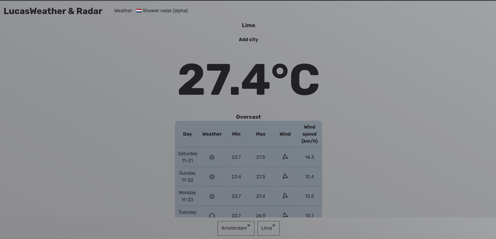

# Lucas Weather

**Live:** [lucasweather.lucashopman.nl](https://lucasweather.lucashopman.nl) · **Rain radar:** [/radar](https://lucasweather.lucashopman.nl/radar)

A personal weather app: current weather, a 14-day forecast and a Buienradar-style rain radar for the Netherlands. I built it because I wanted a weather app of my own, with no ads and no tracking. When the KNMI released their own app, I was curious about how I would handle it myself. The live webapp is on the latest rain radar branch to show off the functionality.



## Features

- **Current weather and 14-day forecast**: min/max temperature, weather type, wind speed and wind direction (with a rotating arrow)
- **Hourly detail per day**: click a day to see charts of temperature and rain by the hour, plus sunrise and sunset
- **Multiple cities**: search worldwide, save several cities and switch between them (press `/` to search)
- **Background that changes with the weather**: the theme follows the current weather code
- **Rain radar**: the last 25 radar frames from KNMI on an OpenStreetMap map, with a time slider

## How some of it works

### Rain radar for Dutch users
The radar talks directly to KNMI's public WMS service:

1. It reads the available time range from `GetCapabilities` and works out the last 25 time steps.
2. It then requests the frame, Leaflet's ImageOverlay puts it over the map of The Netherlands.
3. It requests the frame with the zoom size of the leaflet map.
4. The slider changes the `index` which changes the current timestep and the current frame used.

### City search
I split all the city names of the world in small JSON files. When typing in two letters, the searchbar shows all the suggestions. This is all inside the browser and no external API is called.

## Stack

- **React 19 + TypeScript**, built with **Vite** into a static site
- **React Router** for the weather and radar pages
- **Chart.js** (react-chartjs-2) for the hourly charts
- **Leaflet** (react-leaflet) with OpenStreetMap tiles for the radar

## Running it locally

```bash
npm install
npm run dev      # development server
npm run build    # static build in dist/
```

No API keys needed: Open-Meteo and the KNMI WMS endpoint are both public.

## Data & credits

- Weather forecasts: [Open-Meteo](https://open-meteo.com/) (CC BY 4.0)
- Rain radar: [KNMI Data Platform](https://dataplatform.knmi.nl/), dataset `radar_forecast_2.0`
- Map tiles: © [OpenStreetMap](https://www.openstreetmap.org/copyright) contributors

## Nice things I could add

- [ ] Installable PWA, so it works like a real app on your phone
- [ ] More detail in the daily view
- [ ] Put a rain graph inside the slider
- [ ] Make use of React suspense instead of simply conditionally rendering things based on if I received the data or not. For a more advanced approach, maybe use tanstack query
